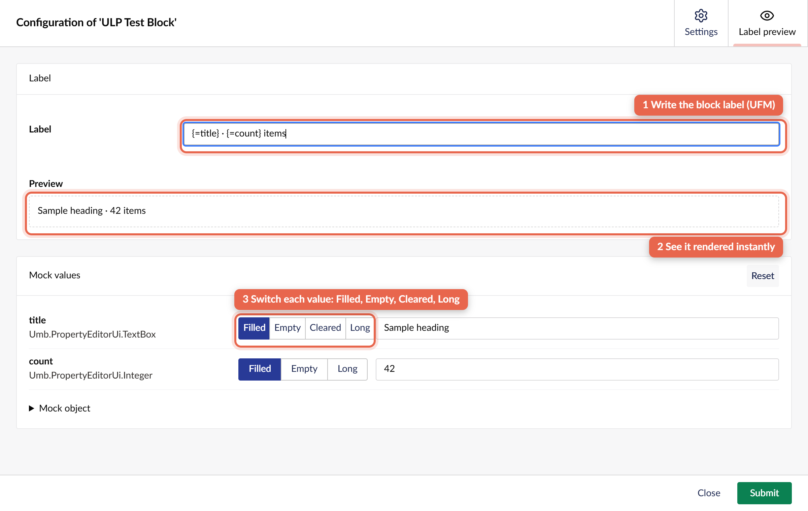
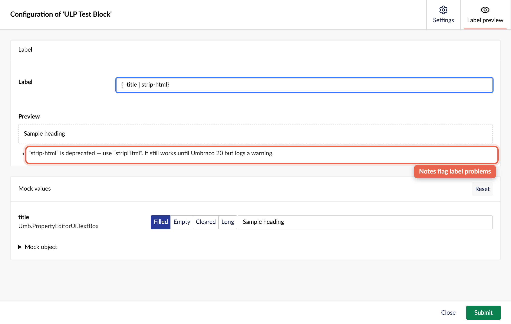

#  UFM Label Preview for Umbraco

[](https://umbraco.com)
[](LICENSE)

See how a block's label will render while you're still configuring it.

Block labels use [Umbraco Flavored Markdown (UFM)](https://docs.umbraco.com/umbraco-cms/17.latest/model-your-content/property-editors/umbraco-flavored-markdown),
but when you configure a block type there's no content yet, so you can't see the result. This package adds a
**Label preview** tab to the block type editor (Block List, Block Grid, Block RTE and Block Single). The tab shows the
Label field, a live preview rendered with **mock data**, and a panel for flipping each referenced property between
**Filled**, **Empty**, **Cleared** and **Long**, so you can check your `||`, `?:` and `| fallback` branches and your truncation.


## Screenshots



Switch a value to **Empty** to see how the label looks when a field is blank:


Switch it to **Long** to check how a long value wraps:


`$settings` values from the settings model get their own mock row:


Notes flag problems in the label, such as a deprecated filter name:



## Features

- **Live preview.** The label is rendered by Umbraco's own UFM renderer (`umb-ufm-render`), so the output matches what
  editors will see.
- **Realistic mock values.** Each mock has the same shape the property's editor stores, e.g. rich text is
  `{ markup }`, a media picker is a list of media entries. Settings are under `$settings`, and the block index is
  under `$index`.
- **Filled / Empty / Cleared / Long switches** for every referenced property, plus an editable sample value for text,
  numbers, toggles and rich text markup.
- **Clear notes** for anything that can't be previewed: lookups of real content (`umbContentName`,
  `umbMemberName`, `umbElementName`, `umbFormName`), custom UFM components from other packages, unknown aliases, and missing settings types.
- **Same Label field.** The Label field on this tab is the same value as on the Settings tab, and edits save through
  the normal path.

## Installation

```bash
dotnet add package Umbraco.Community.UfmLabelPreview
```

Restart the site, open a Block List / Block Grid / Rich Text / Block Single data type, open a block type and choose
the **Label preview** tab.

## What it doesn't do

- **No real content.** Values are always mocks. Components that look up real items (`umbContentName`,
  `umbMemberName`, `umbElementName` (Umbraco 18+), `umbFormName` (Umbraco Forms), and `umbLink` on anything other than a Multi URL Picker) are shown as
  placeholders such as `‹Content name: picker›`.
- **Custom UFM components** from other packages are shown as placeholders (their behaviour can't be mocked
  reliably). **Custom UFM filters** do run, on the mock data.
- **Unsupported editors** (Block List/Grid inside a block, Image Cropper, Upload Field, and third-party editors) get an
  empty `{}` placeholder value and a note.
- It never changes how labels are saved or rendered at runtime. It's a configuration-time aid only.

## How mocks are built

Mocks are chosen by the data type's property editor schema alias (falling back to the UI alias). Shapes were checked
against the Umbraco 17 backoffice source:

| Editor (schema alias) | Filled mock | Verified against |
|---|---|---|
| `Umbraco.TextBox`, `Umbraco.TextArea`, `Umbraco.EmailAddress`, `Umbraco.Plain.String`, `Umbraco.MarkdownEditor`, `Umbraco.RadioButtonList` | string | `property-editors/text-box/property-editor-ui-text-box.element.ts:18`, `textarea/…textarea.element.ts:25`, `radio-button-list/…radio-button-list.element.ts:16`, `markdown-editor/…markdown-editor.element.ts:21` |
| `Umbraco.Integer`, `Umbraco.Decimal` | `42`, `4.2` | `property-editors/number/types.ts:1-2` |
| `Umbraco.TrueFalse` | `true` | `property-editors/toggle/types.ts:1` |
| `Umbraco.RichText` | `{ markup: "<p>…</p>" }` | `rte/types.ts:4-7` (`blocks` is optional) |
| `Umbraco.DropDown.Flexible`, `Umbraco.CheckBoxList` | `["Option A"]` | `dropdown/…dropdown.element.ts:36`, `checkbox-list/…checkbox-list.element.ts:30` |
| `Umbraco.Tags`, `Umbraco.MultipleTextstring` | string array | `tags/…tags.element.ts:23`, `multiple-text-string/…multiple-text-string.element.ts:17` |
| `Umbraco.DateTime` | `"2026-03-14 09:30:00"` | `date-picker/…date-picker.element.ts:105-117` |
| `Umbraco.DateOnly`, `Umbraco.TimeOnly`, `Umbraco.DateTimeUnspecified`, `Umbraco.DateTimeWithTimeZone` | `{ date, timeZone }` | `date-time/property-editor-ui-date-time-picker-base.ts:345-420`, `date-time-with-time-zone-picker/types.ts:1-6` |
| `Umbraco.ColorPicker` | `{ label, value }` | `color-picker/types.ts:1-6` |
| `Umbraco.Slider` | `{ from, to }` | `slider/types.ts:1-6` |
| `Umbraco.ContentPicker`, `Umbraco.MemberPicker` | non-GUID string | `document-picker/…document-picker.element.ts:18`, `member-picker/…member-picker.element.ts:16` |
| `Umbraco.MultiNodeTreePicker` | `[{ type: "document", unique: "mock-document-1" }]` | `content-picker/components/input-content/input-content.element.ts:78-82` |
| `Umbraco.ElementPicker` (Umbraco 18+) | non-GUID string array | `elements/property-editor/element-picker/element-picker-property-editor-ui.element.ts` |
| `Umbraco.MediaPicker3` | `[{ key, mediaKey, mediaTypeAlias, focalPoint, crops }]` | `media/media/property-editors/types.ts:1-9` |
| `Umbraco.MultiUrlPicker` | `[{ name: "Sample link", url, type: "external" }]` (no `unique`) | `multi-url-picker/link-picker-modal/types.ts:3-14` |
| anything else | `{}` + "not previewable" note | |

Paths are relative to `src/Umbraco.Web.UI.Client/src/packages/` in the Umbraco-CMS repo.

- **Empty** is `undefined`, the same as a property that has never been filled in.
- **Cleared** is `""`, what text editors (TextBox, TextArea, Email, Markdown, code editor) store once a value is
  typed and then deleted. It's only offered for those editors.
- **Long** gives strings of at least 400 characters, several long paragraphs of rich text, and lists of 12 items.
- No mock value ever contains a GUID-shaped id, so core's lookup components never send a request (enforced by a
  unit test).

Behaviour worth knowing, which the preview reproduces faithfully:

- In Umbraco 17 the `fallback` filter only replaces an empty string. A property that has never been filled is
  `undefined`, so `{= title | fallback:Untitled }` renders empty for it, but `Untitled` once it's been cleared. Compare
  **Empty** and **Cleared** to see both. Use `${ title || 'Untitled' }` to cover both cases.
- `${ alias }` on an object value (rich text, pickers) prints `[object Object]`. The preview adds a note when this
  happens.

The value passed to the renderer mirrors core:

- `{ ...content, $settings, $index }` for List, Grid and RTE blocks.
- `{ ...content, $settings }` for Block Single, which has no `$index`.
- `$settings` is `undefined` when the block has no settings element type.

## Compatibility

One package covers Umbraco 17, 18 and 19. It has no C# code, so the same NuGet package serves all three.

| Umbraco | Package |
|---|---|
| 17.x | Supported. Verified on 17.8.2 (Block List, Grid, Single and RTE, deprecated-filter notes, the label manual matrix) |
| 18.x | Supported. Verified on 18.2.1 and 18.3.2 (Block List, Grid, Single and RTE, including the Element Picker mock) |
| 19.x | Supported. Verified on 19.0.0-rc1 (Block List, Grid, Single and RTE, including the Element Picker mock, .NET 11 SDK). Not run on a 19.1 release |

The NuGet dependency range is `[17.0.0, 20.0.0)`. Umbraco 19 targets .NET 11. The package stays on net10.0, which
a .NET 11 site can consume.

Kebab-case filter aliases (`strip-html`, `title-case`, `word-limit`) are deprecated. From Umbraco 18 their manifests
are gone, but component filters such as `{= x | strip-html}` still work: core maps them to the camelCase names and logs a
deprecation warning, until Umbraco 20. Inside `${ }` only the camelCase names (`stripHtml`, `titleCase`, `wordLimit`)
work. The preview notes either case and still renders what core renders. Otherwise it uses whatever filters are
registered on your site.

 Install for development only (optional)

Block types are normally configured in development and deployed with uSync or Umbraco Deploy, so you may not want
this tool on production. Even if it ships, the cost is small: there's no C#, nothing runs on the public site, and the
JavaScript only loads when the Label preview tab is opened.

To leave it out of Release builds, add a condition to the package reference:

```xml
<PackageReference Include="Umbraco.Community.UfmLabelPreview" Version="0.2.0"
                  Condition="'$(Configuration)' == 'Debug'" />
```

Release builds and `dotnet publish -c Release` then leave out the DLL and `App_Plugins/UfmLabelPreview`.

Caveat: Umbraco Cloud and most CI pipelines build every environment in Release, so the tool won't be on Cloud
environments either. If you configure blocks on a Cloud dev environment, leave the condition off. `Debug` is only a
convention, so a custom configuration or property works too.
Support is best-effort.

## Internal / undocumented API reliance

Retest these on every Umbraco minor:

| API | Status | Risk |
|---|---|---|
| `workspaceView`, `Umb.Condition.WorkspaceAlias`, `UMB_PROPERTY_DATASET_CONTEXT`, `umb-property`, `UmbLitElement`, extension registry | Public, documented | Low |
| `umb-ufm-render` (`markdown`, `value`, `inline`, `umb-ufm-resolved` event) | Public export; the event is undocumented | Low/Medium |
| Workspace aliases `Umb.Workspace.Block{List,Grid,Rte,Single}Type` | Undocumented string constants | Medium |
| Block config keys `label`, `contentElementTypeKey`, `settingsElementTypeKey` | Stored data model | Low |
| Label value shape `{ ...content, $settings, $index }` | Implementation detail mirrored here | Medium: the preview could drift from runtime |
| UFM token rules (component `{alias: …}` / marker, `${ … }` expressions) | Implementation detail mirrored by the scanner | Medium |
| `UmbDocumentTypeDetailRepository` (element type + compositions), `UmbDataTypeItemRepository` | Public exports, sparsely documented | Low/Medium |
| Lookup components only request GUID-shaped ids | Implementation detail | Medium. Lookup tokens are replaced anyway, so this is defence in depth |

## Privacy and security

- Client-side only, with no server code.
- No content lookups. The only requests are for the block's element type and data type **definitions**, made
  through core's public repositories.
- No telemetry (`allowTelemetry: false`).
- The label is rendered by core's UFM pipeline (marked + DOMPurify); this package never builds HTML from the label.

## Development

```bash
node --test                                                        # pure-module tests (tests/*.test.mjs), no dependencies
dotnet build src/Umbraco.Community.UfmLabelPreview.slnx
dotnet run --project src/TestSites/V17 --launch-profile Umbraco.Web.UI   # Umbraco 17, Clean starter kit (https://localhost:44397)
dotnet run --project src/TestSites/V18 --launch-profile Umbraco.Web.UI   # Umbraco 18, Clean starter kit (https://localhost:44398)
dotnet run --project src/TestSites/V19 --launch-profile Umbraco.Web.UI   # Umbraco 19 RC, Clean starter kit, needs the .NET 11 SDK (https://localhost:44399)
dotnet pack src/Umbraco.Community.UfmLabelPreview -c Release
```

Each test site seeds the `ULP` fixtures on first start: element types plus Block List, Block Grid, Block Single and Block RTE data types (see `src/TestSites/Shared`). The Element Picker fixture is added on 18 and 19 only.

There's no build step for the client code. The files in `wwwroot/App_Plugins/UfmLabelPreview/` are served as they
are. While editing JS, tick **Disable cache** in the browser's DevTools Network tab, because the version in the URL
doesn't change between edits and a refresh can show old code.

When releasing, bump the version in `umbraco-package.json`, the csproj `<Version>` and `CHANGELOG.md` together.
Umbraco appends the manifest version to the view's URL (`?umb__rnd=<version>`), and the view passes that query on
to its own imports, so browsers pick up every changed file.

## License

[MIT](LICENSE) © Nathaniel Nunes
