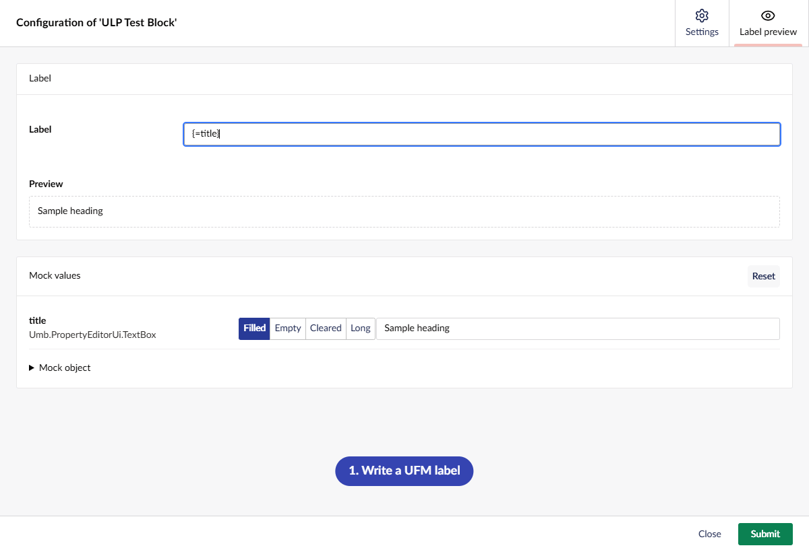
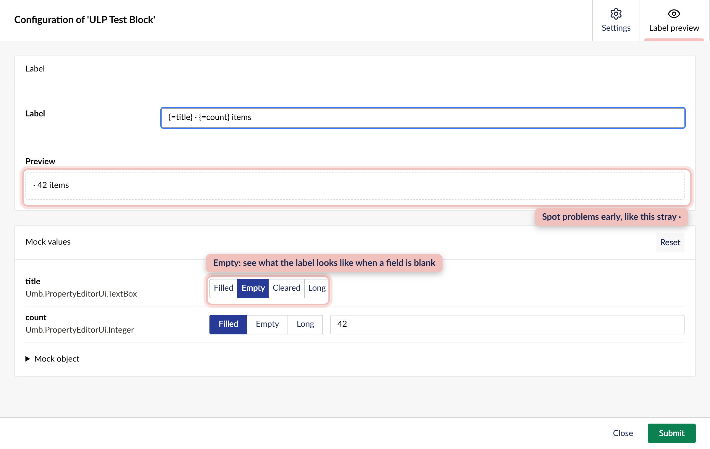
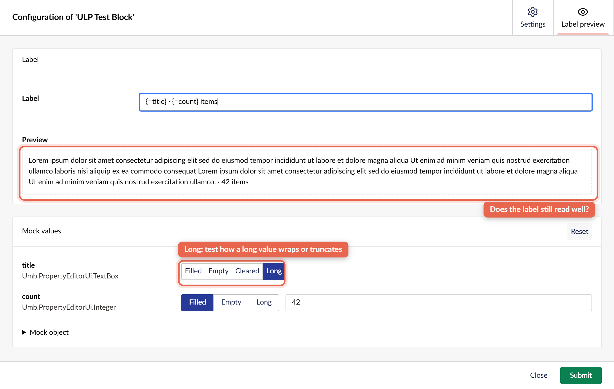
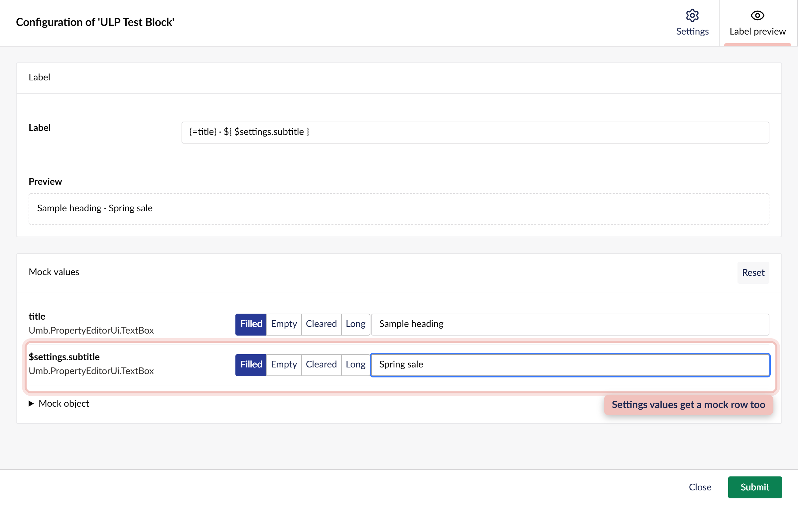
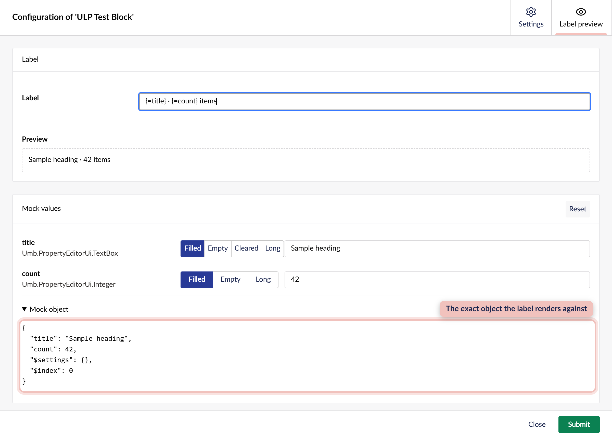
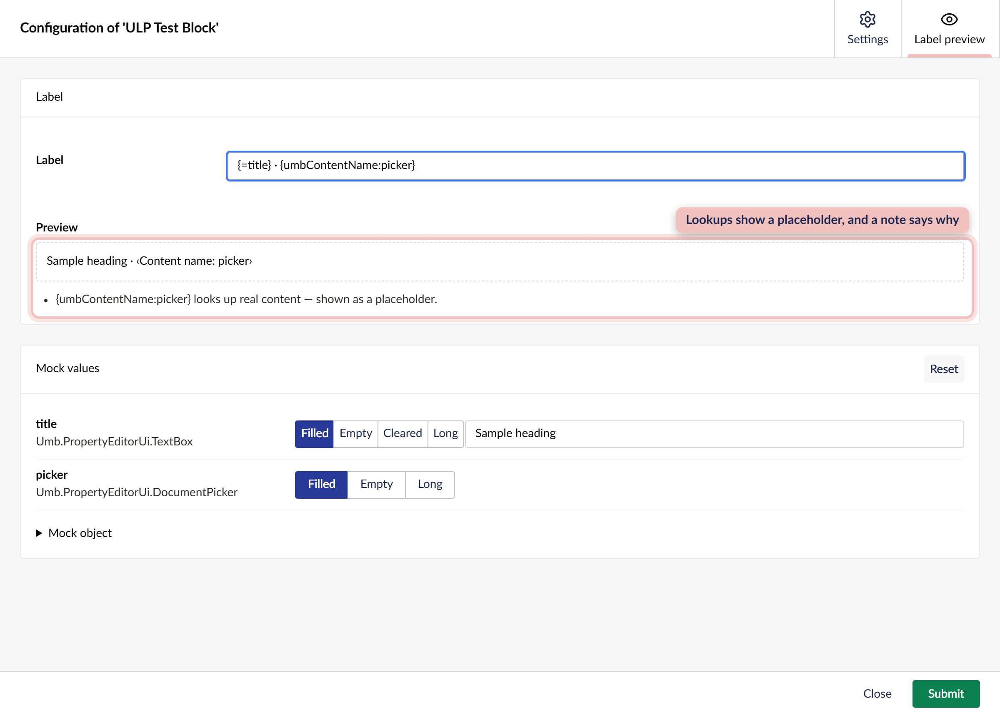

#  UFM Label Preview for Umbraco

[](https://umbraco.com)
[](LICENSE)

See how a block's label will render while you're still configuring it.

Block labels use [Umbraco Flavored Markdown (UFM)](https://docs.umbraco.com/umbraco-cms/17.latest/model-your-content/property-editors/umbraco-flavored-markdown),
but when you configure a block type there's no content yet, so you can't see the result. This package adds a
**Label preview** tab to the block type editor (Block List, Block Grid, Block RTE and Block Single). The tab shows the
Label field, a live preview rendered with **mock data**, and a panel for flipping each referenced property between
**Filled**, **Empty**, **Cleared** and **Long**, so you can check your `||`, `?:` and `| fallback` branches and your truncation.



## Screenshots


Switch a value to **Empty** to see how the label looks when a field is blank:



Switch it to **Long** to check how a long value wraps:



`$settings` values from the settings model get their own mock row:



Open **Mock object** to see the exact object the label renders against:



Lookups of real content are replaced by a placeholder and a note:



Notes flag problems in the label, such as a deprecated filter name:


## Features

- The label is rendered by Umbraco's own UFM renderer (`umb-ufm-render`), so the output matches what editors will see.
- Every referenced property gets a mock value with the same shape its editor stores, and you can switch it between
  **Filled**, **Empty**, **Cleared** and **Long**.
- Anything that can't be previewed gets a note: lookups of real content (`umbContentName`, `umbMemberName`,
  `umbElementName`, `umbFormName`), custom UFM components from other packages, unknown aliases and missing settings types.
- The Label field on this tab is the same value as on the Settings tab, and edits save through the normal path.

## Installation

```bash
dotnet add package Umbraco.Community.UfmLabelPreview
```

Restart the site, open a Block List / Block Grid / Rich Text / Block Single data type, open a block type and choose
the **Label preview** tab.

## Limitations

- Values are always mocks. Components that look up real items (`umbContentName`, `umbMemberName`, `umbElementName`
  (Umbraco 18+), `umbFormName` (Umbraco Forms), and `umbLink` on anything other than a Multi URL Picker) are shown as
  placeholders such as `‹Content name: picker›`.
- Custom UFM components from other packages are shown as placeholders, because their behaviour can't be mocked
  reliably. Custom UFM filters do run, on the mock data.
- Unsupported editors (Block List/Grid inside a block, Image Cropper, Upload Field and third-party editors) get an
  empty `{}` placeholder value and a note.
- It never changes how labels are saved or rendered at runtime. It's a configuration-time aid only.

## Mock values

Each mock has the same shape as the property editor stores. Switching a property changes what the label sees:

- **Filled**: a sample value, which you can edit.
- **Empty**: no value at all, like a property that was never filled in.
- **Cleared**: an empty string, like a text field that was typed in and then deleted (text editors only).
- **Long**: 400+ characters for text, several paragraphs for rich text and 12 items for lists.

Settings are under `$settings` and the block index under `$index`. Open **Mock object** to see the whole object.

## Compatibility

One package covers Umbraco 17, 18 and 19, and it has no C# code. It has been tested on 17.8.2, 18.2.1, 18.3.2 and
19.0.0-rc1 (Block List, Grid, Single and RTE). The NuGet dependency range is `[17.0.0, 20.0.0)`. Umbraco 19 targets
.NET 11, and this package stays on net10.0, which a .NET 11 site can consume.

## Install for development only (optional)

Block types are normally configured in development and deployed with uSync or Umbraco Deploy, so you may not want
this tool on production. Even if it ships, the cost is small: there's no C#, nothing runs on the public site, and the
JavaScript only loads when the Label preview tab is opened.

To leave it out of Release builds, add a condition to the package reference:

```xml
<PackageReference Include="Umbraco.Community.UfmLabelPreview" Version="0.2.0"
                  Condition="'$(Configuration)' == 'Debug'" />
```

Release builds and `dotnet publish -c Release` then leave out the DLL and `App_Plugins/UfmLabelPreview`.

Caveat: Umbraco Cloud and most CI pipelines build every environment in Release, so the tool won't be on Cloud
environments either. If you configure blocks on a Cloud dev environment, leave the condition off. `Debug` is only a
convention, so a custom configuration or property works too.


## Privacy and security

- It runs only in the backoffice and has no server code.
- It never looks up your content. The only requests are for the block's element type and data type definitions, made through Umbraco's own repositories.
- It sends no telemetry.
- The label is rendered by Umbraco's UFM renderer, and this package never builds HTML from it.

## How it works

Mock shapes, Umbraco's quirks and the APIs this relies on are in [docs/how-it-works.md](docs/how-it-works.md).

## Development

```bash
node --test                                                        # pure-module tests (tests/*.test.mjs), no dependencies
dotnet build src/Umbraco.Community.UfmLabelPreview.slnx
dotnet run --project src/TestSites/V17 --launch-profile Umbraco.Web.UI   # Umbraco 17, Clean starter kit (https://localhost:44397)
dotnet run --project src/TestSites/V18 --launch-profile Umbraco.Web.UI   # Umbraco 18, Clean starter kit (https://localhost:44398)
dotnet run --project src/TestSites/V19 --launch-profile Umbraco.Web.UI   # Umbraco 19 RC, Clean starter kit, needs the .NET 11 SDK (https://localhost:44399)
dotnet pack src/Umbraco.Community.UfmLabelPreview -c Release
```

Each test site seeds the `ULP` fixtures on first start: element types plus Block List, Block Grid, Block Single and Block RTE data types (see `src/TestSites/Shared`). The Element Picker fixture is added on 18 and 19 only.

There's no build step for the client code. The files in `wwwroot/App_Plugins/UfmLabelPreview/` are served as they
are. While editing JS, tick **Disable cache** in the browser's DevTools Network tab, because the version in the URL
doesn't change between edits and a refresh can show old code.

When releasing, bump the version in `umbraco-package.json`, the csproj `<Version>` and `CHANGELOG.md` together.
Umbraco appends the manifest version to the view's URL (`?umb__rnd=<version>`), and the view passes that query on
to its own imports, so browsers pick up every changed file.

## License

[MIT](LICENSE) © Nathaniel Nunes
